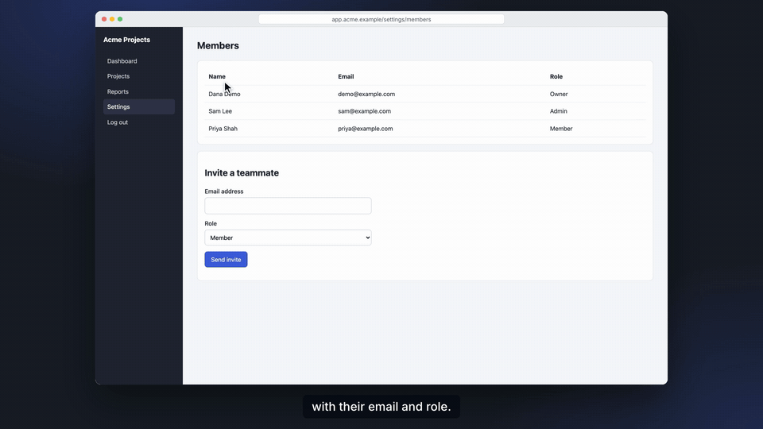
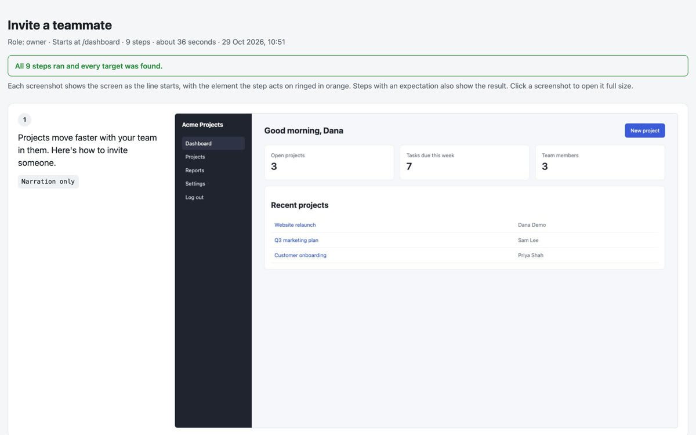
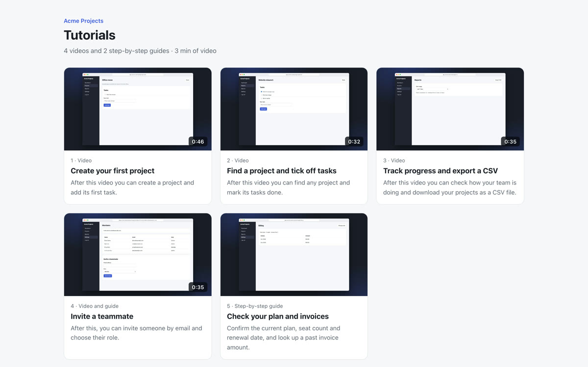
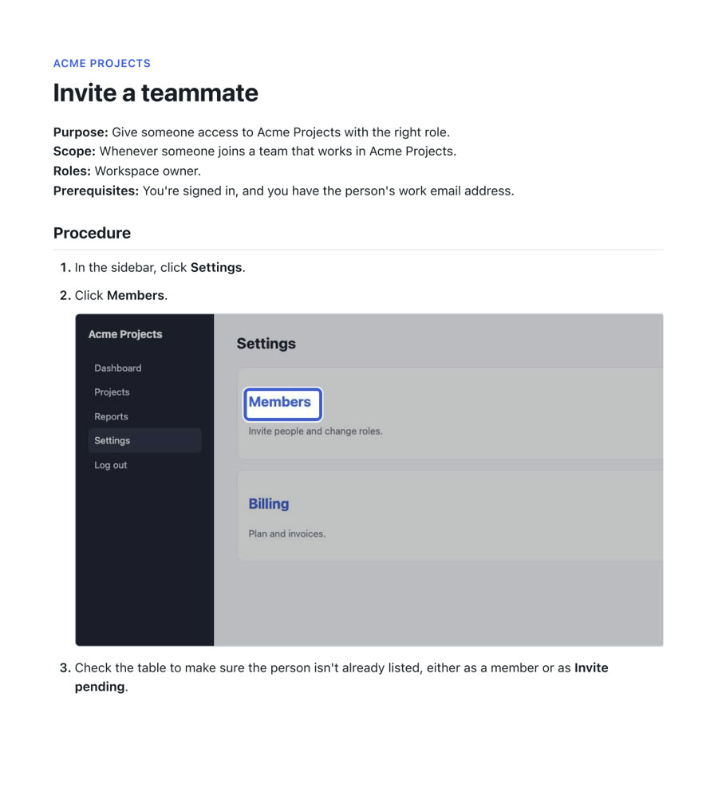
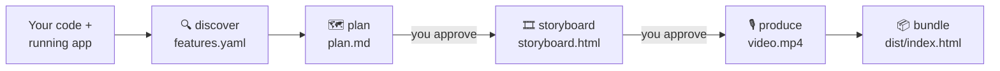

<div align="center">

# walkcast

**Your app's tutorial videos and SOPs, made by Claude.**<br>
Narrated, recorded and rendered on your machine, and checked against your real app.

[](https://docs.claude.com/en/docs/claude-code)
[](LICENSE)
[](#privacy)



<sub>Real output, unedited: the sample app's “Invite a teammate” tutorial. Narration, pointer, zoom, highlights and captions are all generated.</sub>

**[▶ Watch the 1-minute demo, with sound](docs/walkcast-demo.mp4)** (walkcast made its own trailer, too)

</div>

---

## The problem

Every product needs onboarding videos and step-by-step guides. Almost nobody has them, because making them is miserable: write a script, click through the app while recording, fumble, record again, cut, caption, export. Then the next release moves a button and the whole thing is wrong.

Screen recorders still need a person to click through every flow, and to do it again after every UI change. AI video tools can make a talking avatar, but they've never seen your app.

## What walkcast does

You run one command in your app's repo, and Claude Code takes it from there:

1. **🔍 Maps every feature.** It reads your code, crawls the running app as each kind of user, and *probes* every form and button to see what actually works. A button that does nothing gets flagged, not filmed.
2. **🗺️ Plans a learning path.** Short videos, one job each, plus SOPs for the procedures people must get exactly right, each with a script. **You approve.**
3. **🎞️ Storyboards every step.** It replays each tutorial in your real app, pins each step to a real element, and screenshots it next to its narration. **You approve.**
4. **🎙️ Produces the videos.** A natural local voice reads the script. The browser is recorded as the narrator talks, and each click lands as the narrator finishes saying the button's name. Then it renders 1080p with a smooth pointer, zooms, highlights and captions. Every video is checked against the storyboard you approved.
5. **📦 Bundles everything.** You get MP4s with chapters and captions, SOP PDFs with annotated screenshots, and one page that plays it all and can be hosted anywhere.

**When your app changes, run it again.** Every output is fingerprinted, so walkcast knows which tutorials are out of date and remakes only those.

## What you get

| Storyboard, for your approval | One page with everything | SOPs with ringed screenshots |
| --- | --- | --- |
|  |  |  |

## Quick start

In Claude Code:

```
/plugin marketplace add walkcast/walkcast
/plugin install tutorials@walkcast
```

Then, in your app's repo:

```
/tutorials:start
```

That's the only command to remember. It works out where things stand, runs the next stage, and keeps going. It stops only to ask you something or to get your approval. Come back to it any time, for example after a release.

**You'll need:**
- Node 22 or later, and Claude Code.
- `ffmpeg` and [`uv`](https://docs.astral.sh/uv/): `brew install ffmpeg uv` on macOS.
- Disk space for a one-time download of the voice the first time it narrates: about 1.2 GB.

Claude installs the browser it needs by itself.

## Why it's different

- **Grounded in your app, not a template.** Every step is resolved to a real element on a real page, and checked against the text the page should show afterwards.
- **It checks its own work:**
  - Recordings are compared with the approved storyboard.
  - Narration timing is measured.
  - Lines the voice cut short are caught and redone.
  - A tour that changed after you approved it won't be recorded.
- **A narrator you choose by ear.** Pick from voice samples. On Apple Silicon you can also use Ming-3.0's voices, or a recording of your own voice.
- **Plain files in your repo.** Plans, scripts, tours and SOPs live in `tutorials/` as YAML and Markdown, so you review changes in pull requests like any other code.
- **Open models, no cloud services:**
  - Kokoro (Apache-2.0) for the voice, or Ming-3.0 (MIT) on Apple Silicon
  - Playwright for the recording
  - HyperFrames and GSAP for the rendering

## How it works



| Command | What happens |
| --- | --- |
| `/tutorials:start` | **Start here, and come back here.** Works out where things stand and runs the stages below in order |
| `/tutorials:discover` | Finds how to run and log in to the app, reads the code, crawls each role, probes what works, reads your brand colours and public address, and writes `tutorials/features.yaml` |
| `/tutorials:plan [audience]` | Proposes the videos and SOPs in `tutorials/plan.md`, revises them with you, and writes each tutorial's steps, script and SOP |
| `/tutorials:storyboard [ids]` | Replays each tutorial in the running app and builds a `storyboard.html` with a screenshot next to every line |
| `/tutorials:produce [ids]` | Lets you pick a voice and music, then narrates, records and renders each video, and reviews it in `review.html` |
| `/tutorials:bundle [ids]` | Gathers videos, captions, chapters, thumbnails and SOP PDFs into `tutorials/dist/`, with an `index.html` that works from disk or any host |

<details>
<summary><b>Under the hood</b></summary>

- **Discover** combines a code map, a crawl per role (screenshots and accessibility snapshots) and a probe that submits each form with a marker and reloads to see whether it was saved.
- **Storyboard** resolves each step's visible label to a saved locator (`{ role: button, name: Save }`). If the UI changes, it re-resolves the step from the label and notes the repair.
- **Voice:**
  - Kokoro reports when each word is spoken, so the pointer clicks as the narrator finishes saying "Send invite".
  - Ming-3.0, an option on Apple Silicon through MLX, doesn't, so Qwen3-ForcedAligner times its words. It agrees with Kokoro's own timings to within about 30 ms.
- **Recording** happens at twice the screen size while the narration plays. The pointer you see is drawn afterwards, along the same eased path the real mouse took.
- **Rendering** is a HyperFrames composition per video: the browser window, pointer, ripples, rings, zoom, captions, and title and closing cards. ffmpeg then levels the sound and ducks the music under the voice.
- **Demo data** is put back before every run with your reset command, so each recording starts from the same data.

</details>

## Privacy

Recording, narration and rendering all run locally. Nothing is uploaded to a video or voice service. The only thing that leaves your machine is what Claude Code itself sends to Claude while it works on your repo. Test-account passwords live in `tutorials/.env`, which is gitignored.

## Try it on the sample app

The repo includes a small project-management app with a login and a few deliberately unfinished features, plus the feature map, plan, scripts, tours and SOPs walkcast wrote for it. The videos and bundle are rebuilt on your machine.

```bash
git clone https://github.com/walkcast/walkcast && cd walkcast
npm install --prefix plugins/tutorials
cd examples/sample-app
claude --plugin-dir ../../plugins/tutorials
```

Then run `/tutorials:start`. The test account is `demo@example.com` / `demo1234`. The folder already holds walkcast's plan and tours, so it picks up at the storyboards. To watch it start from nothing, move `tutorials/` aside first.

## FAQ

**What kinds of apps work?** Any web app you can run locally and open in a browser, in any framework. Logins work with test accounts, or with single sign-on, where you log in once yourself.

**What about apps that change data?** walkcast asks for a command that puts your demo data back, such as a seed script or a database reset, and runs it before every tour.

**Can I edit what the narrator says?** Yes. Each tutorial's script lives in `tutorials/<id>/tour.yaml`. Change a line and run it again; only that line is re-narrated, and only that video re-rendered.

**Which languages?** English is the best tested. Kokoro also speaks Spanish, French, Italian, Portuguese and Hindi; Ming-3.0 on Apple Silicon adds German, Korean, Japanese and Chinese.

**Does it need a GPU?** No. Kokoro runs on the CPU, faster than real time.

## Develop

```bash
node --test tests/e2e.test.mjs              # both sample apps, about a minute
E2E_FULL=1 node --test tests/e2e.test.mjs   # also narrates, records, renders and bundles a video per app
```

See [CLAUDE.md](CLAUDE.md) for how the pieces fit together.

## Roadmap

- [x] discover: code map, crawl, probe, brand
- [x] plan
- [x] storyboard
- [x] produce: Kokoro (or Ming-3.0), Playwright, HyperFrames, with checks
- [x] bundle: videos, captions, chapters, thumbnails, SOP PDFs, index page
- [ ] refresh: re-run after a release, repair broken steps, re-render only what changed

> **Status: early.** Every stage works end to end on the sample apps. Try it on your app and [open an issue](https://github.com/walkcast/walkcast/issues) with what breaks.

## License

[MIT](LICENSE). Demo music: “Inspired” by Kevin MacLeod (incompetech.com), [CC BY 4.0](https://creativecommons.org/licenses/by/4.0/).
